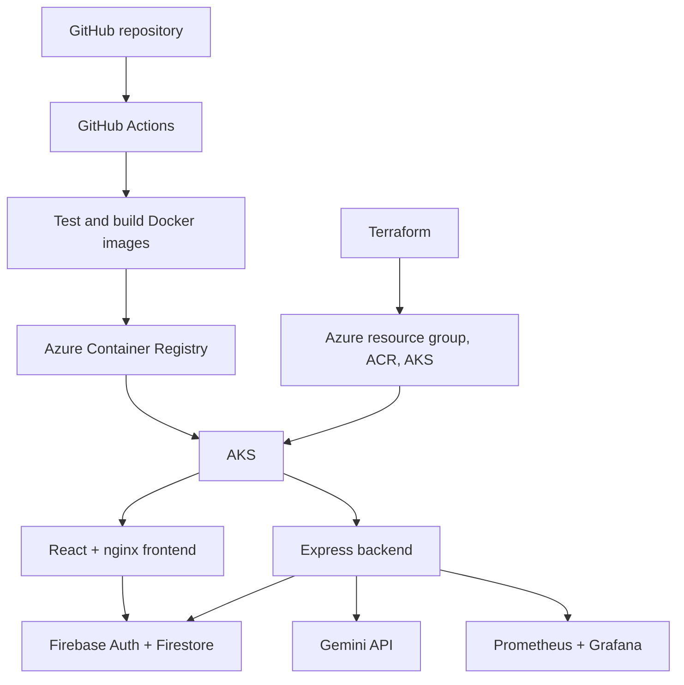

# Azure deployment

This repository contains the architecture in the diagram:



The frontend serves `/api/*` through nginx to the internal backend service. The backend verifies Firebase ID tokens before answering chat requests. Prometheus scrapes `/metrics` over the cluster network. Grafana and Prometheus are internal services.

## 1. Provision Azure resources

Install Azure CLI and Terraform. Log in with `az login`, select your subscription, then run:

```powershell
cd infra/terraform
terraform init
terraform apply -var="subscription_id=<subscription-id>" -var="name_prefix=<unique-lowercase-prefix>"
terraform output
```

Terraform creates an Azure resource group, Basic ACR using legacy registry RBAC permissions, a one-node AKS cluster, and an `AcrPull` role assignment for the AKS kubelet identity. The default node size is `Standard_D4ads_v7`, which the second subscription allows in Canada Central. One node uses four regional and Dadsv7-family vCPUs, exactly matching that subscription's current limits. This leaves no quota for a surge node during upgrades, and the single node provides no redundancy. Use `-var="node_vm_size=<allowed-size>"` if deploying to a subscription that requires another SKU. ACR names are global; use `-var="acr_name=<unique-registry-name>"` when the default `<name_prefix>acr` is already taken. The default region is `canadacentral`; set `-var="location=<region>"` if needed. This starter uses **local Terraform state**. Keep it backed up and never commit it. For a shared environment, migrate state to an Azure Storage backend before team members run Terraform.

### Switching subscriptions

Do not reuse an existing Terraform state against a different Azure subscription. Select a separate Terraform CLI workspace. Keep the `name_prefix` already recorded in that workspace's state; give the registry a different globally unique name if necessary:

```powershell
terraform -chdir=infra/terraform workspace new paid  # use 'workspace select paid' if it already exists
terraform -chdir=infra/terraform workspace show
terraform -chdir=infra/terraform plan -var="subscription_id=<new-subscription-id>" -var="name_prefix=<existing-prefix-in-this-workspace>" -var="acr_name=<globally-unique-registry-name>"
```

When returning to the original subscription, run `terraform -chdir=infra/terraform workspace select default` before any plan or apply. The workspace name only selects local Terraform state; the `subscription_id` variable selects the Azure subscription. Review both before applying.

## 2. Set up GitHub to deploy

Create an Azure Entra application or user-assigned managed identity with a GitHub OIDC federated credential. Because the deploy job uses the `production` GitHub environment, older repositories normally use the subject `repo:<owner>/<repo>:environment:production`. Repositories created or renamed after July 15, 2026 use an immutable subject with owner and repository IDs; use the subject shown in GitHub's OIDC configuration for this repository. Give that identity `AcrPush` and `Reader` on the registry (the workflow calls `az acr show`), plus `Azure Kubernetes Service Cluster Admin Role` on the cluster to fetch admin credentials. Configure GitHub environment protection if desired.

In the GitHub repository's **production environment**, set these secrets:

| Secret | Value |
| --- | --- |
| `AZURE_CLIENT_ID` | Azure OIDC application or identity client ID |
| `AZURE_TENANT_ID` | Azure tenant ID |
| `AZURE_SUBSCRIPTION_ID` | Azure subscription ID |
| `GEMINI_API_KEY` | Gemini API key |
| `FIREBASE_SERVICE_ACCOUNT_JSON` | Full Firebase service account JSON for token verification |
| `GRAFANA_ADMIN_PASSWORD` | Grafana admin password |
| `CLOUDFLARE_TUNNEL_TOKEN` | Optional token for the Cloudflare Tunnel serving `keepmealive.niraajojha.com` |

Set these GitHub environment variables:

| Variable | Value |
| --- | --- |
| `ACR_NAME` | Terraform `acr_name` output |
| `AKS_NAME` | Terraform `aks_name` output |
| `AZURE_RESOURCE_GROUP` | Terraform `resource_group` output |
| `VITE_FIREBASE_API_KEY` | Firebase web app API key |
| `VITE_FIREBASE_AUTH_DOMAIN` | Firebase web app auth domain |
| `VITE_FIREBASE_PROJECT_ID` | Firebase project ID |
| `VITE_FIREBASE_APP_ID` | Firebase web app ID |
| `VITE_GOOGLE_CALENDAR_CLIENT_ID` | Optional Google Calendar client ID |
| `VITE_GOOGLE_CALENDAR_REDIRECT_URI` | Optional Calendar redirect URI |

The Firebase web app values are embedded in the React bundle at build time, as Firebase expects. Keep the Gemini key and service account JSON only in GitHub secrets. The Docker build contexts exclude local `.env` files.

Push to `main` or start the workflow manually. Pull requests run tests and build the frontend but do not deploy. The deploy job builds commit-tagged images, pushes them to ACR, creates Kubernetes secrets, applies the manifests, and waits for rollouts.

## 3. Check the deployment

```powershell
az aks get-credentials --resource-group <resource-group> --name <aks-name> --admin
kubectl -n qdoc get pods,services
kubectl -n qdoc get service frontend -w
```

When Azure assigns an external IP to `frontend`, open `http://<external-ip>`. For the backend health check, open `http://<external-ip>/api/health`. To inspect metrics locally:

```powershell
kubectl -n qdoc port-forward service/prometheus 9090:9090
kubectl -n qdoc port-forward service/grafana 3000:3000
```

Prometheus is at `http://localhost:9090`; Grafana is at `http://localhost:3000` (username `admin`, password from the GitHub secret). Query `qdoc_http_requests_total` to see backend request counts.

## 4. Add the Cloudflare subdomain

In Cloudflare, open **Networking → Tunnels**, create a remotely managed tunnel named `qdoc-aks`, and choose **Docker**. Copy only the token from the displayed command into the GitHub `production` environment secret `CLOUDFLARE_TUNNEL_TOKEN`. Do not commit the token or the full command.

In the tunnel's **Routes**, add a **Published application** with hostname `keepmealive.niraajojha.com` and service URL `http://frontend.qdoc.svc.cluster.local:80`. Cloudflare creates the DNS record for this route; if an old DNS record already uses `keepmealive`, remove it before adding the route.

Run the deployment workflow again from GitHub Actions or push a commit. The optional Cloudflare step creates the Kubernetes secret and starts one `cloudflared` pod. Wait for the tunnel to show **Healthy**, then test `https://keepmealive.niraajojha.com/` and `https://keepmealive.niraajojha.com/api/health`. Add `keepmealive.niraajojha.com` to Firebase Authentication **Settings → Authorized domains** and test sign-in and chat. The existing Azure load balancer remains available during this transition; remove it only after the HTTPS hostname works.

## Production follow-up

The manifest still exposes HTTP on a public Azure load balancer for initial verification and rollback. After the Cloudflare hostname works, change the frontend service to `ClusterIP` to remove direct public HTTP access. The one-node AKS cluster and `emptyDir` Prometheus storage are for development only; use persistent monitoring storage for a resilient service. Existing SMS integration calls a separate Twilio Function and is not deployed by this pipeline.

## Local development

The existing Firebase Functions emulator flow still works. The backend keeps its `api` Firebase Function export. Its new container entry point is `npm start` in `app/functions`. For direct local container-style execution, provide `GEMINI_API_KEY`, `FIREBASE_PROJECT_ID`, and `GOOGLE_APPLICATION_CREDENTIALS` pointing to a Firebase service account JSON file.

## References

- [Azure GitHub OIDC setup](https://learn.microsoft.com/en-us/azure/developer/github/connect-from-azure-openid-connect)
- [GitHub OIDC subject format](https://docs.github.com/en/actions/how-tos/secure-your-work/security-harden-deployments/oidc-in-azure)
- [AKS and ACR integration](https://learn.microsoft.com/en-us/azure/aks/cluster-container-registry-integration)
- [Firebase ID token verification](https://firebase.google.com/docs/auth/admin/verify-id-tokens)
