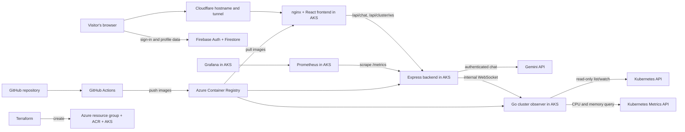
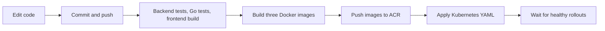

# QDoc / VaxTrack: a beginner's guide to the whole project

This document explains the project as it exists in this repository today, how it reached its current Azure deployment, and what happens when someone uses the website. It assumes no prior experience with web development or cloud infrastructure.

**The short version:** VaxTrack is a vaccination planning website. A patient signs in, saves a profile and vaccination history, sees calculated eligibility and reminders, and can ask a chat assistant questions about that information. The site is hosted in containers on Azure Kubernetes Service (AKS). A separate, restricted page shows live information about that Kubernetes cluster.

The public site is **vaxtrack.niraajojha.com**. The Firebase project configured in the repository is **q-doc-challenge**. The Azure resource group is **qdocniraaz-rg**, the cluster is **qdocniraaz-aks**, and the container registry is **qdocniraaz2acr.azurecr.io**. The public product was renamed to VaxTrack; existing QDoc technical IDs remain in place so Azure resources, Firebase users, and deployment credentials do not need to be recreated. These names identify resources; they are not passwords.

> **Scope note:** This guide describes the code and deployment configuration in the repository, plus the setup decisions made while bringing this project online. It does not claim that every idea in older planning files was implemented. Never paste passwords, API keys, Firebase service-account JSON, tunnel tokens, or Terraform state into this document.

## Contents

1. [The problem and the first version](#1-the-problem-and-the-first-version)
2. [Words you need to know](#2-words-you-need-to-know)
3. [The current system in one picture](#3-the-current-system-in-one-picture)
4. [What lives in this repository](#4-what-lives-in-this-repository)
5. [What a patient does on the website](#5-what-a-patient-does-on-the-website)
6. [What happens to a request](#6-what-happens-to-a-request)
7. [How the Azure infrastructure was created](#7-how-the-azure-infrastructure-was-created)
8. [How a change reaches production](#8-how-a-change-reaches-production)
9. [How the domain reaches the app](#9-how-the-domain-reaches-the-app)
10. [How the live cluster map works](#10-how-the-live-cluster-map-works)
11. [Security and access](#11-security-and-access)
12. [Monitoring, costs, and current limits](#12-monitoring-costs-and-current-limits)
13. [The project story, in order](#13-the-project-story-in-order)
14. [Useful CLI commands](#14-useful-cli-commands)
15. [How to explain this to someone else](#15-how-to-explain-this-to-someone-else)
16. [Deep dive: browser state and Firestore documents](#16-deep-dive-browser-state-and-firestore-documents)
17. [Deep dive: vaccine rule evaluation](#17-deep-dive-vaccine-rule-evaluation)
18. [Deep dive: chat, reminders, and calendar](#18-deep-dive-chat-reminders-and-calendar)
19. [Deep dive: images, Kubernetes objects, and networking](#19-deep-dive-images-kubernetes-objects-and-networking)
20. [Deep dive: credentials and the deployment job](#20-deep-dive-credentials-and-the-deployment-job)
21. [Deep dive: the observer and live browser rendering](#21-deep-dive-the-observer-and-live-browser-rendering)
22. [Rebuild this architecture from a blank repository](#22-rebuild-this-architecture-from-a-blank-repository)
23. [Trace a failure from symptom to cause](#23-trace-a-failure-from-symptom-to-cause)
24. [Exact current gaps and how to describe them](#24-exact-current-gaps-and-how-to-describe-them)

## 1. The problem and the first version

The starting problem was simple: vaccination schedules are difficult for patients to remember and interpret. A patient may have several previous doses, an upcoming booster, and medical or age-based rules that affect eligibility. The original challenge was to build an app that accepts a profile, applies vaccine rules, shows a timeline, and sends or simulates reminders. The older [README.md](README.md) records that goal.

The first useful version was a **React** website backed by **Firebase Authentication** and **Cloud Firestore**. React draws the pages. Firebase Authentication handles accounts. Firestore stores user profiles and calculated results. A rule engine in the client evaluates a profile against a set of vaccine rules. The dashboard displays the results. The project then gained a chat assistant and test reminder actions.

Later, the goal grew from “make the app work” to “run and demonstrate a complete cloud deployment.” That is why this repository now also contains Dockerfiles, Terraform, Kubernetes manifests, a GitHub Actions workflow, monitoring, a Cloudflare Tunnel, and a live cluster map.

## 2. Words you need to know

| Word | Plain-English meaning | Its role here |
| --- | --- | --- |
| Frontend | The part that runs in a visitor's browser. | React pages for login, profile, dashboard, chat, and cluster map. |
| Backend | Server code that receives requests and calls other services. | Express handles authenticated chat, health checks, metrics, and the cluster WebSocket bridge. |
| API | A defined way for software components to talk. | Browser requests such as `/api/chat`; Kubernetes API calls from the observer. |
| Firebase Authentication | Google's account and sign-in service. | Creates users and issues ID tokens after login. |
| Firestore | Google's document database. | Stores user profiles and rule-engine results. |
| Gemini API | A remote AI service. | Generates chat answers using context supplied with the request. |
| Docker image | A packaged application plus the files needed to run it. | Separate images for the frontend, backend, and cluster observer. |
| Container | A running instance of an image. | The actual processes inside AKS pods. |
| Container registry | A storage location for images. | Azure Container Registry (ACR) holds the three application images. |
| Kubernetes | Software that schedules and maintains containers. | Runs the app, restarts unhealthy pods, and connects services. |
| AKS | Azure's managed Kubernetes service. | The Kubernetes cluster used by this project. |
| Node | A virtual machine that runs Kubernetes workloads. | The current AKS system pool has one node. |
| Pod | Kubernetes's smallest deployable unit; usually one container here. | Frontend, backend, observer, Prometheus, Grafana, and cloudflared each run in pods. |
| Deployment | A Kubernetes instruction to keep a chosen number of pods running. | Each app component has one replica in its Deployment. |
| Service | A stable network address in front of pods. | `backend` and `cluster-observer` are internal; `frontend` is also exposed by an Azure load balancer. |
| Namespace | A grouping of Kubernetes resources. | Application resources live in the `qdoc` namespace. |
| Terraform | Code that creates cloud resources. | Creates the Azure resource group, ACR, AKS, and image-pull permission. |
| CI/CD | Automated verification and deployment after a code change. | GitHub Actions tests, builds images, pushes them to ACR, and deploys to AKS. |
| Secret | A value such as an API key that must be protected. | GitHub environment secrets become Kubernetes Secrets during deployment. |
| OIDC federation | A way for GitHub Actions to obtain short-lived Azure access without storing an Azure password. | The deployment job signs in to Azure through a federated Entra credential. |
| DNS | The system that turns a domain name into a destination. | Cloudflare routes `vaxtrack.niraajojha.com` to the tunnel. |
| Reverse proxy | A server that forwards a request to another service. | nginx sends browser `/api/*` requests to the backend. |
| WebSocket | A connection that stays open so the server can send updates. | Carries live Kubernetes snapshots to the cluster page. |
| Prometheus | A metrics collector and query system. | Scrapes the backend's `/metrics` endpoint. |
| Grafana | A dashboard UI for metrics. | Uses Prometheus as its data source. |

### An analogy

Think of the system as a restaurant. The browser is the customer-facing counter. The backend is the kitchen. Firestore is the record book. The container registry is the warehouse of prepared equipment. AKS is the building manager that makes sure each station is staffed and connected. GitHub Actions is the delivery process that installs a new version when the recipe changes. Terraform is the blueprint used to build the building in the first place.

## 3. The current system in one picture



There are **two different kinds of data** in this picture. Patient account and profile data live in Firebase. Cluster resource data come from the Kubernetes API. The cluster map does not need access to patient records.

## 4. What lives in this repository

| Path | What it contains | When it runs |
| --- | --- | --- |
| [app/client](app/client) | React application, Vite build, browser code, nginx config, frontend Dockerfile. | React runs in the browser; nginx runs in an AKS pod. |
| [app/functions](app/functions) | Express backend, Firebase Function export, chat route, WebSocket bridge, backend tests and Dockerfile. | Node.js runs in the backend pod. |
| [app/cluster-observer](app/cluster-observer) | Go program that watches Kubernetes resources and emits snapshots. | Runs in its own AKS pod. |
| [app/contracts](app/contracts) | Shared constants and older API/schema planning documents. | Constants are imported by the client; some prose files are historical plans. |
| [infra/terraform](infra/terraform) | Azure infrastructure definitions and outputs. | Terraform CLI runs when provisioning or changing Azure resources. |
| [k8s](k8s) | Kubernetes YAML describing pods, services, permissions, monitoring, and tunnel. | Applied to AKS by GitHub Actions. |
| [.github/workflows/deploy.yml](.github/workflows/deploy.yml) | CI and deployment recipe. | GitHub Actions runs it on pull requests and pushes to `main`. |
| [firebase.json](firebase.json), [firestore.rules](firestore.rules) | Firebase configuration and Firestore access rules. | Firebase uses these when deployed through the Firebase tooling. |
| [DEPLOYMENT.md](DEPLOYMENT.md) | Operator-focused setup instructions. | Read by a person; it does not execute. |

The code has a few historical layers. For example, [app/contracts/endpoints.md](app/contracts/endpoints.md) sketches endpoints such as reminders and nearby clinics, but the current Express server does **not** register those routes. Similarly, [app/contracts/firestore-schema.md](app/contracts/firestore-schema.md) is a proposed schema with profiles and clinics; the running client currently uses `users/{uid}` and `ruleEngineResult/{uid}`. When explaining the running system, follow the code and deployed manifests.

## 5. What a patient does on the website

### Sign up and sign in

The routes are defined in [app/client/src/App.jsx](app/client/src/App.jsx). A visitor can open `/register` or `/login`. Firebase Authentication handles the email-and-password account. After sign-in, Firebase gives the browser an **ID token**: a short-lived proof of who the user is. `ProtectedRoute` redirects an unauthenticated visitor to login.

Signing into the **Firebase Console** is different. That signs an administrator into Google's management site. It does not create a user in this website. A website user has to register or otherwise exist in this app's Firebase Authentication project.

### Save a profile

The profile page asks for information such as name, date of birth, postal code, risk factors, and vaccination history. On save, [Profile.jsx](app/client/src/pages/profile/Profile.jsx) writes a document at `users/{uid}` in Firestore. The `uid` is the Firebase user's unique ID.

The client then calls [computeAndStoreRuleEngineResult](app/client/src/backend/parseProfileCallEngine.js). Despite the folder name `backend`, this file is imported by the **browser application**. It evaluates the profile against [ruleSet.js](app/client/src/backend/ruleSet.js) using [ruleEngine.js](app/client/src/backend/ruleEngine.js), then writes the output to `ruleEngineResult/{uid}` in Firestore.

This distinction matters: eligibility calculation is currently performed in client-side JavaScript, while the Express backend is mainly used for chat and cluster streaming. The result is useful for the project demo, but it should not be presented as a clinical decision service or an authoritative medical record.

### Read the dashboard and eligibility view

[Dashboard.jsx](app/client/src/pages/dashboard/Dashboard.jsx) reads the saved result, displays vaccine names, dates, and statuses, and computes “days until due” for presentation. [VaccineEligibility.jsx](app/client/src/components/VaccineEligibility.jsx) renders a separate eligibility table. [VaccinationHistory.jsx](app/client/src/pages/vaccination/VaccinationHistory.jsx) reads the saved user document to display history.

The rule engine can return statuses such as `ELIGIBLE`, `DUE_SOON`, `OVERDUE`, and `NOT_ELIGIBLE`. The dashboard maps these to labels such as Upcoming, Due, and Overdue. Those labels are a UI interpretation of the stored result, not a separate server calculation.

### Ask the chat assistant

The chat widget sends a question and selected profile/eligibility context to `/api/chat`. The backend checks the Firebase ID token, constructs a prompt with that supplied context and recent conversation messages, calls Gemini, and returns an answer. The recent conversation is held in an in-memory `Map` keyed by Firebase UID, so it disappears when the backend restarts. See [ChatWidget.jsx](app/client/src/components/chat/ChatWidget.jsx), [api.js](app/client/src/api/api.js), and [index.js](app/functions/src/index.js).

The backend authenticates the caller, but the chat context itself comes from the browser request. The server is not independently loading and validating the patient's Firestore record for every chat answer. That is an important limit if the app were ever used for high-trust medical decisions.

### Send test reminders and optionally sync a calendar

The dashboard has **manual test actions** for email and SMS. Its email action calls EmailJS from the browser. Its SMS action refers to a separate Twilio Function URL configured through browser environment variables. That Twilio Function is outside this repository's AKS deployment, and the current helper should be tested independently before describing SMS as reliable. There is no scheduled reminder worker in the Kubernetes manifests.

Google Calendar sync uses Google Identity Services in the browser and then calls the Calendar API. It needs a client ID and user consent. The earlier setup deliberately left the Calendar client ID unset, so this is an optional path, not a required part of the deployed core flow. The redirect-URI build variable exists in the pipeline, but the current calendar helper does not read it.

## 6. What happens to a request

### Loading a page

1. The browser requests `https://vaxtrack.niraajojha.com/dashboard`.
2. Cloudflare sends that request through the tunnel into the `qdoc` namespace.
3. nginx in the frontend pod serves the built React files.
4. For a React route such as `/dashboard`, nginx falls back to `index.html`; React Router then chooses the right page.
5. The browser talks directly to Firebase Auth and Firestore for sign-in and user documents.

### Calling chat

1. The browser obtains a Firebase ID token from the signed-in user.
2. It sends `POST /api/chat` with an `Authorization: Bearer ...` header and a JSON question/context body.
3. nginx strips the `/api` prefix and proxies the request to the internal `backend:8080` service as `POST /chat`.
4. Express verifies the token using Firebase Admin credentials.
5. Express calls Gemini with the question and context, then returns JSON containing the answer.

Other useful mappings are `/api/health` to backend `/health` and `/api/cluster/ws` to backend `/cluster/ws`. The public nginx config blocks `/api/metrics`; Prometheus reads backend `/metrics` on the internal cluster network.

### Why a reverse proxy is useful

The browser sees one site origin, `vaxtrack.niraajojha.com`, for both pages and application API calls. nginx knows where to forward `/api/*`. The backend does not need a separate public address, and the WebSocket can use the same hostname.

## 7. How the Azure infrastructure was created

Terraform files in [infra/terraform](infra/terraform) declare four Azure resources:

1. A **resource group** named from `name_prefix`, which groups related Azure resources.
2. A **Basic Azure Container Registry**, which stores Docker images.
3. An **AKS cluster**, which runs the containers. Its default region is Canada Central and its configured AKS tier is Free.
4. An **AcrPull role assignment** so the AKS kubelet can pull images from ACR.

`name_prefix` is a short lowercase naming stem, not a password or special Azure feature. In this project it leads to names such as `qdocniraaz-rg` and `qdocniraaz-aks`. ACR names must be globally unique, so the actual registry was configured as `qdocniraaz2acr`.

Terraform's `node_count` currently defaults to **1**, and the default VM size is `Standard_D4ads_v7`. One such node uses four vCPUs. This configuration came out of an Azure quota problem: the first attempted cluster needed eight vCPUs when only six regional vCPUs remained, and a quota increase request could not be fulfilled. We also inspected other VM-family quotas and considered changing subscriptions and VM sizes. The final working subscription and configuration used a one-node, four-vCPU system pool. “One AKS cluster” and “one AKS node” are different: the cluster is the managed Kubernetes environment; a node is a VM inside it.

Terraform emits the resource group name, AKS name, registry name, and registry login server as outputs. The registry login server is `qdocniraaz2acr.azurecr.io`.

Terraform creates infrastructure; it does **not** create the Firebase project, Cloudflare DNS, GitHub secrets, or the patient account. The current Terraform state is local and ignored by Git. Losing that state makes future Terraform changes harder, so it must be backed up securely. See [DEPLOYMENT.md](DEPLOYMENT.md) for setup commands and subscription-switching notes.

### What Terraform does not deploy

Terraform does not currently install the app pods. That work is performed by `kubectl apply` in GitHub Actions, using [k8s/app.yaml](k8s/app.yaml), [k8s/monitoring.yaml](k8s/monitoring.yaml), [k8s/cluster-observer.yaml](k8s/cluster-observer.yaml), and [k8s/cloudflare-tunnel.yaml](k8s/cloudflare-tunnel.yaml).

## 8. How a change reaches production

The workflow is [deploy.yml](.github/workflows/deploy.yml). A **pull request** runs verification; it does not deploy. A **push to `main`** or a manual workflow run passes through verification and then deployment.



During deployment, GitHub Actions:

1. Checks out the repository and runs the existing backend tests, Go observer tests, Go image build, and frontend build.
2. Signs in to Azure using a federated GitHub OIDC credential tied to an Entra app or managed identity. This avoids storing a reusable Azure password in the workflow.
3. Builds frontend, backend, and observer Docker images, each tagged with the Git commit SHA. A tag lets us identify the exact code running in AKS.
4. Pushes the images to ACR.
5. Creates or updates Kubernetes Secrets from the GitHub production environment secrets.
6. Replaces image and project placeholders in the Kubernetes YAML, applies the resources, and waits until Deployments report a successful rollout.
7. If the Cloudflare tunnel token is configured, ensures the cloudflared pod is running.

The frontend image is a **multi-stage build**: Node/Vite builds static React assets, and nginx serves those assets. The backend image runs Node/Express. The observer image compiles a Go binary and runs it in a small container. Local `.env` files are excluded from the image build contexts.

### Why the lockfiles mattered

`package-lock.json` records exact npm dependency versions. The workflow uses `npm ci`, which expects a lockfile and installs from it consistently. One early pipeline problem was resolved after the client lockfile was committed. Other early deployment work included fixing the frontend Docker build context and GitHub-to-Azure login.

### GitHub settings involved

The `production` GitHub environment holds names such as `ACR_NAME`, `AKS_NAME`, `AZURE_RESOURCE_GROUP`, and Firebase web configuration as variables. It holds Azure identity IDs, Gemini credentials, Firebase service-account JSON, Grafana password, and Cloudflare tunnel token as secrets. The Firebase **web app configuration** is embedded in the client build; the **Firebase service-account JSON** grants server-side privileges and must remain protected.

## 9. How the domain reaches the app

The domain is managed in Cloudflare. A **Cloudflare Tunnel** is an outbound connection from the `cloudflared` pod in AKS to Cloudflare. Cloudflare's published application route points `vaxtrack.niraajojha.com` to the internal frontend service.

At first, the subdomain did not resolve because its DNS and tunnel route were not yet set up correctly. After the route and token were configured, the domain began reaching the AKS frontend. Cloudflare handles public HTTPS; the tunnel forwards traffic to the frontend service inside Kubernetes.

The Kubernetes frontend Service is also currently type `LoadBalancer`, so Azure exposes a separate public HTTP entry point. The tunnel is the hostname used for the HTTPS site, but the load balancer has not been removed. A later hardening step could change that Service to `ClusterIP` after confirming the tunnel meets all needs.

The React site itself is served by nginx. It is **not** deployed by this workflow through Firebase Hosting, even though [firebase.json](firebase.json) retains Firebase Hosting configuration from an earlier setup.

## 10. How the live cluster map works

The route is `/ops/cluster`. It was added after the main app was deployed, to provide a real-time view of AKS resources rather than a static mockup.

```mermaid
sequenceDiagram
    participant Page as React cluster page
    participant Backend as Express WebSocket bridge
    participant Observer as Go observer
    participant K8s as Kubernetes API
    Page --> Backend: Open /api/cluster/ws; send Firebase ID token
    Backend --> Backend: Verify token and clusterViewer claim
    Backend --> Observer: Open internal /ws with shared token
    Observer --> K8s: List resources, then watch for changes
    K8s --> Observer: Nodes, pods, services, EndpointSlices, deployments
    Observer --> Backend: JSON snapshot as WebSocket text
    Backend --> Page: Forward JSON snapshot
    Page --> Page: Draw nodes, pods, connections and inspector
```

The Go observer reads the Kubernetes service-account token and cluster certificate automatically mounted in its pod. Its **ClusterRole** allows `get`, `list`, and `watch` on selected resources, plus read access to node and pod metrics. It has no write verbs. It first lists existing resources, then opens Kubernetes watch streams so it can react to additions, changes, and deletions. If a watch ends, it lists again. The Metrics API is polled every 15 seconds; those CPU and memory numbers are more periodic than the resource watches.

The observer converts raw Kubernetes data into smaller snapshots. Each snapshot contains:

- **Nodes:** name, readiness, and CPU/memory percentages when metrics are available.
- **Pods:** name, namespace, assigned node, phase, restart count, waiting reason, and usage when available.
- **Services:** name, type, and IDs of pods found through EndpointSlices.
- **Deployments:** desired and available replica counts.

An **EndpointSlice** records network endpoints belonging to a Service. The page uses those records to draw service-to-pod links. That is a real relationship reported by Kubernetes, but it is **not** a measurement of live packet traffic. A red pod reflects failure information such as `CrashLoopBackOff`; hot node colors reflect reported usage. Clicking a resource shows its snapshot fields. The namespace dropdown filters what the page draws.

The observer is an internal `ClusterIP` Service, and the backend is also internal. The browser cannot query the Kubernetes API directly. The backend accepts the browser's WebSocket only after it verifies a Firebase token with the `clusterViewer` custom claim. The backend then connects to the observer using an internal shared token stored in a Kubernetes Secret.

There was one production bug after the first cluster-page deployment: the observer emitted JSON text, but the backend forwarded it to the browser as a binary WebSocket frame. The page could not parse that frame and showed “error” while waiting for data. The bridge was changed to forward a **text frame**, and the deployment passed. The page's visual design was then changed from a dark neon style to the current lighter operations view.

### What the cluster map does not yet do

It does not measure or animate real network packets, record a durable deployment history, replay old cluster states, or display full logs and traces. These ideas appeared in the expanded architecture proposal, but they require additional data sources and storage. The current deployment also does not include ArgoCD, Azure Key Vault with External Secrets Operator, OpenTelemetry, or Azure Monitor integration. Prometheus and Grafana **are** present.

## 11. Security and access

There are several separate identities and permissions:

| Identity | What it can do |
| --- | --- |
| Website user | Signs in through Firebase Authentication and accesses their own allowed Firestore documents. |
| Cluster viewer user | A website user whose Firebase ID token contains the `clusterViewer` custom claim; can open the read-only cluster stream. |
| Backend Firebase service account | Lets server code verify Firebase tokens and perform admin operations when explicitly invoked. |
| GitHub deployment identity | Obtains Azure access through OIDC to push images and deploy to AKS. |
| AKS kubelet identity | Pulls private images from ACR using `AcrPull`. |
| Observer Kubernetes service account | Reads selected cluster resources and metrics through read-only RBAC. |
| Cloudflare tunnel token | Lets cloudflared connect the published hostname to the internal frontend. |

Firestore rules in [firestore.rules](firestore.rules) allow an authenticated user to read and write only their own `users/{uid}` and `ruleEngineResult/{uid}` documents. Other collection paths are denied by the catch-all rule. This is why the user UID is used as the document ID.

The `clusterViewer` claim is granted with [grant-cluster-viewer.js](app/functions/scripts/grant-cluster-viewer.js) to an **existing website Authentication user**. Signing in to Firebase Console does not create such a user. After a claim changes, the user signs out and back in to obtain a fresh ID token. In this deployment, the designated test website account was granted access after it was found in Firebase Authentication.

The observer token is generated during the first GitHub deployment if its Secret does not already exist. Do not print or commit that token. The frontend never receives the backend's Firebase service-account JSON or Gemini API key.

**Current security boundaries have limits.** The frontend Azure load balancer still serves public HTTP. The eligibility engine runs in the browser and writes a result document the user is allowed to modify. The chat server verifies who called it, but accepts patient context provided by that browser. The reminder integrations are test-oriented. These are important facts to mention if someone asks whether this is ready for clinical production use.

## 12. Monitoring, costs, and current limits

### Monitoring

The Express backend counts completed HTTP requests and exposes a Prometheus-formatted `qdoc_http_requests_total` metric. Prometheus scrapes that internal endpoint every 15 seconds. Grafana has Prometheus configured as its data source. These tools are distinct from the live cluster map: Prometheus tracks backend metrics over time; the observer streams current Kubernetes object state.

Prometheus stores data in an `emptyDir` volume with seven-day retention configured in its container. `emptyDir` is tied to the pod, so its stored metrics can disappear when the pod is replaced. Grafana is internal and has no public Service in these manifests. Its admin password comes from a GitHub secret through a Kubernetes Secret.

### Costs and capacity

The AKS control-plane tier is configured as Free, but the underlying VM node, disks, network load balancer, public IP, ACR storage, and any billable network use may still cost money. Firebase, Gemini, EmailJS, Twilio, and Cloudflare have their own plans and usage rules. This repository does not contain a reliable monthly price, and real charges depend on the Azure subscription and usage. Check the Azure Cost Management view for the actual bill.

One node is inexpensive relative to a larger cluster but is also a **single point of failure**. It cannot provide node-level redundancy. With a four-vCPU family quota and one four-vCPU node, there may be no room for an extra surge node during an upgrade. The current Deployments mostly use one replica, so a pod replacement can briefly affect that service.

### Other limits worth knowing

- The cluster map is read-only and shows current state; it does not store history.
- CPU and memory display depends on the Kubernetes Metrics API. If metrics are unavailable, resource state can still appear without usage percentages.
- Chat conversation memory is in the backend process and resets on restart.
- Eligibility rules are application data and include simplified assumptions. They require independent review before real medical use.
- Email and SMS buttons are manual test flows, not an automated schedule.
- The repository includes some planned contracts and Firebase Hosting configuration that are not part of the current AKS request path.

## 13. The project story, in order

This sequence combines the repository history with the setup decisions made while deploying it. It is a **milestone narrative**, not a claim that every action has an exact recorded date.

1. **Start with the vaccination challenge.** The team built profile input, vaccine rules, vaccination history, eligibility views, reminders, and a dashboard in a React application.
2. **Add Firebase.** Website users could register and sign in. The app began storing profile data and calculated results in Firestore. Firebase rules limited the relevant documents to their owners.
3. **Add chat and optional integrations.** An Express/Firebase Functions backend handled Gemini chat. The dashboard gained manual EmailJS email, an external Twilio-based SMS path, and optional Google Calendar sync.
4. **Decide to demonstrate cloud delivery.** A GitHub repository already existed. Terraform, Dockerfiles, Kubernetes YAML, monitoring, and GitHub Actions were added to move from a locally working app to an AKS deployment.
5. **Work through Azure quota.** An early AKS creation requested eight vCPUs but the first subscription had only six regional vCPUs left. A quota increase was not available. Different family quotas and subscriptions were considered. The deployment settled on one four-vCPU node in a working subscription.
6. **Create Azure resources.** Terraform produced the resource group, AKS cluster, and `qdocniraaz2acr` registry. An image-pull role linked AKS to the private registry.
7. **Connect GitHub to Azure.** A federated credential was configured for the deployment identity. GitHub production secrets and variables were added. An initial Azure login failure was corrected; the client lockfile and Docker build context were also fixed.
8. **Deploy the app.** GitHub Actions tests and builds the images, pushes them to ACR, then deploys the frontend, backend, Prometheus, and Grafana to AKS.
9. **Add the public hostname.** A Cloudflare Tunnel and published route connected the original product hostname to the frontend. A DNS lookup failure was resolved as part of that setup. The public hostname was later changed to `vaxtrack.niraajojha.com` without rebuilding AKS.
10. **Add real-time cluster visibility.** A Go observer, read-only Kubernetes permissions, Express WebSocket bridge, and protected React page at `/ops/cluster` were merged and deployed. A website account received the `clusterViewer` claim.
11. **Fix the first live-stream issue.** The backend began forwarding JSON snapshots as WebSocket text instead of binary. The cluster page was then restyled into the current light operations layout.

There are Git commits for the infrastructure pipeline, Cloudflare Tunnel, cluster observer, WebSocket fix, and visual redesign. The most useful commit history can be viewed with `git log --oneline`. The earlier conversation also records the quota, credential, DNS, and access decisions that do not appear as full code changes.

## 14. Useful CLI commands

These examples use PowerShell. Install and sign in to Azure CLI first with `az login`, and select the intended subscription if needed. Commands that read resources are safe to use for inspection. Be careful with commands that apply or delete resources.

### Inspect the live AKS cluster without installing local kubectl

```powershell
az aks command invoke -g qdocniraaz-rg -n qdocniraaz-aks `
  --command "kubectl -n qdoc get pods,services,deployments -o wide"
```

```powershell
az aks command invoke -g qdocniraaz-rg -n qdocniraaz-aks `
  --command "kubectl get nodes -o wide"
```

```powershell
az aks command invoke -g qdocniraaz-rg -n qdocniraaz-aks `
  --command "kubectl top nodes"
```

```powershell
az aks command invoke -g qdocniraaz-rg -n qdocniraaz-aks `
  --command "kubectl -n qdoc logs deployment/backend --tail=50"
```

For a particular pod, first get its name, then run `kubectl -n qdoc describe pod <pod-name>` through `az aks command invoke`. `kubectl top` requires a working Metrics API.

### Check the public request path

```powershell
curl.exe -I https://vaxtrack.niraajojha.com/ops/cluster
curl.exe https://vaxtrack.niraajojha.com/api/health
```

A successful HTML response proves the page is reachable. It does **not** by itself prove that a signed-in browser can receive the protected WebSocket stream.

### Test and build code locally

```powershell
cd app/functions
npm ci
npm test

cd ../client
npm ci
npm run build

cd ../cluster-observer
go test ./...
```

Local development also needs the appropriate Firebase configuration and, for backend calls, credentials and API keys supplied outside Git. The Vite development proxy is set up for a local Firebase Functions emulator on port 5002. For the exact Azure deployment procedure, use [DEPLOYMENT.md](DEPLOYMENT.md).

### Check deployment history

```powershell
git log --oneline -n 15
gh run list --repo niraaz1912/QDoc-challenge --workflow deploy.yml --limit 5
```

The repository's `main` branch is the deployment branch. A successful GitHub Actions run means its tests and configured rollout checks passed. For user-facing problems, also check the page and relevant pod logs.

## 15. How to explain this to someone else

### A one-minute explanation

> “We built a vaccination planning app. Patients sign in with Firebase, enter their profile and vaccination history, and the React app evaluates those details against a rule set stored in code. Firestore stores the profile and results. An Express backend checks Firebase tokens and connects chat requests to Gemini. For deployment, Terraform creates Azure resources, GitHub Actions builds Docker images and pushes them to Azure Container Registry, and AKS runs the containers. Cloudflare Tunnel provides the public HTTPS address. We also built a protected cluster page: a read-only Go service watches the Kubernetes API, Express securely forwards snapshots over WebSockets, and React draws the current nodes, pods, services, and usage.” 

### If someone asks “why use Kubernetes?”

Kubernetes keeps the application containers running, gives them stable internal addresses, and supports rolling out new images. It also makes the infrastructure visible through standard resource types such as nodes, pods, Services, and Deployments. For this project, AKS is both the hosting platform and a platform-engineering demonstration. A simpler hosting service could run a small app with less operational overhead.

### If someone asks “what did CI/CD automate?”

It automated testing, image builds, pushing to ACR, Kubernetes configuration updates, and rollout checks after a push to `main`. Terraform provisioning, Firebase project setup, Cloudflare route setup, and GitHub secret creation were separate setup steps.

### If someone asks “is the cluster page really live?”

Yes: the Go observer uses the Kubernetes list/watch API for resource changes, and it refreshes CPU/memory from the Metrics API every 15 seconds. The browser receives snapshots through a protected WebSocket. It is not a packet-level network monitor or a history playback system.

### If someone asks “what would you improve next?”

Good concrete answers are: remove the direct public HTTP load balancer after tunnel verification; add persistent monitoring storage; make reminder delivery a tested server-side job; have the server calculate or validate eligibility and load chat context from trusted storage; improve automated tests around the full WebSocket path; and add durable cluster history only if playback becomes a real requirement. Those are improvements to the system that exists, not features to claim are already deployed.

## 16. Deep dive: browser state and Firestore documents

### The React component tree

The browser begins at [main.jsx](app/client/src/main.jsx), which mounts `App`. In [App.jsx](app/client/src/App.jsx), `AuthProvider` wraps `BrowserRouter`. This order matters: every routed page can obtain the current user and profile through the authentication context. `ProtectedRoute` checks that context before it renders `AppLayout`. `AppLayout` contains the navigation menu and an `Outlet`, which is where the selected page renders.

A URL change such as `/dashboard` does not normally ask the server for a new HTML page. React Router changes which component is shown inside the already loaded app. A full refresh *does* ask nginx for that URL; its `try_files ... /index.html` rule returns the React entry page, so the same route still opens.

The context object in [AuthContext.jsx](app/client/src/context/AuthContext.jsx) exposes `user`, `userDoc`, `userRuleEngineResult`, loading flags, `signup`, `login`, `logout`, setters, and `refreshComputed`. `useAuth.js` is a small alias for reading that context. The `onAuthStateChanged` listener reacts to a sign-in or sign-out. When a user appears, `refreshComputed(uid)` reads `users/{uid}` and `ruleEngineResult/{uid}` in parallel using `Promise.all`. When the user disappears, it clears the in-memory React state.

On registration, Firebase Authentication first creates the account. The context then optionally updates the account display name and starts a Firestore write for the initial `users/{uid}` document. That write has its own error handler and is not awaited before `signup` returns. The registration page navigates to `/profile`, where the user can enter the detailed data. The difference between an **Auth user** and a **Firestore user document** is useful when debugging: one can exist before the other.

### The two current Firestore document shapes

The current client primarily uses two collections. The following are simplified examples, with fictional values:

```jsonc
// users/{uid} -- conceptual example; Firestore stores timestamps as timestamp values
{
  "displayName": "Sample Patient",
  "email": "sample@example.com",
  "dateOfBirth": "1995-04-17",
  "gender": "FEMALE",
  "postalCode": "R3T 2N2",
  "riskTags": ["DIABETES"],
  "chronicConditions": ["DIABETES"],
  "vaccinationHistory": [
    { "vaccineKey": "TDAP", "date": "2022-05-01" }
  ]
}
```

```jsonc
// ruleEngineResult/{uid} -- abbreviated example
{
  "uid": "same-firebase-user-id-as-document-name",
  "result": [
    {
      "vaccineKey": "TDAP",
      "status": "DUE_SOON",
      "dueDate": "2026-03-01",
      "nextDoseNumber": 2,
      "remainingDoses": 1,
      "matchedClauseId": "example-rule-clause",
      "reasons": ["Example explanation"]
    }
  ]
}
```

The actual profile save also writes fields such as `userId`, `isPrimary`, `firstName`, `lastName`, `phoneNumber`, `familyMembers`, and timestamps. `serverTimestamp()` tells Firestore to fill a timestamp on the server. `setDoc(..., { merge: true })` updates supplied fields without replacing all other fields in that document.

The profile save has two writes in sequence. First it saves the profile to `users/{uid}`. Second it calculates and saves `ruleEngineResult/{uid}`. If the second operation fails, the profile may already be saved while the result is old or missing. The UI reports the evaluation error; it does not roll back the first write. The dashboard can therefore show stale results until the calculation succeeds again.

The Firestore rules file permits a user to read and write only documents whose ID matches their authenticated UID in these two collections. It does not validate the medical meaning of fields or prevent that user from editing their own calculated result through another client. The repository contains no separate server-side rules engine that independently certifies those values.

### What is in memory, what survives

| Data | Where it lives | What happens on refresh or restart |
| --- | --- | --- |
| Current React component state, such as open chat panel | Browser memory | Lost on page refresh. |
| Auth user and loaded Firestore documents in React context | Browser memory, reloaded from Firebase | Reconstructed by the Auth listener when Firebase restores a session. |
| Patient profile and calculated eligibility result | Firestore | Persist until changed or deleted. |
| Chat conversation history used by Express | Backend process memory | Lost when the backend pod restarts. |
| Prometheus time series | `emptyDir` in its pod | Can be lost when the pod is replaced. |
| Kubernetes resource state | Kubernetes API | Continues independently of the cluster-map browser page. |

There are two different Firebase persistence calls in the client: [firebase.js](app/client/src/firebase.js) requests `inMemoryPersistence`, while `AuthContext.jsx` requests `browserLocalPersistence` after the provider mounts. Their coexistence makes session-persistence behavior harder to reason about. Treat the actual browser behavior as something to test, and consolidate these calls before relying on a precise “stays signed in” policy.

## 17. Deep dive: vaccine rule evaluation

### The inputs

The profile form creates a payload with date of birth, gender, postal code, risk tags, chronic conditions, and vaccine entries. It normalizes text and maps vaccine names to the keys used by the rule set. The rule set in [ruleSet.js](app/client/src/backend/ruleSet.js) is data: each vaccine has a key, display name, dose-series settings, and ordered eligibility clauses. A clause may depend on age, risk tags, prior doses, or spacing between doses.

The algorithm in [ruleEngine.js](app/client/src/backend/ruleEngine.js) performs these operations:

1. **Preprocess rules.** Reject duplicate vaccine keys, normalize optional fields, sort clauses by priority with stable tie breakers, and build a lookup by vaccine key.
2. **Normalize the profile.** Put the user's input into the date, age, tag, and vaccination formats the engine expects.
3. **Index doses.** Count documented doses and record last-dose dates by vaccine key; aliases can count toward a rule's series.
4. **Evaluate every vaccine.** Find the best matching eligibility clause. If none matches, return `NOT_ELIGIBLE` for that vaccine.
5. **Resolve the series.** Choose required-dose count and schedule options, including any override from the matched clause.
6. **Calculate the next dose.** Use the series and history to determine the next dose number, due date, and remaining count.
7. **Assign a status.** A past due date becomes `OVERDUE`; a date within the configured window becomes `DUE_SOON`; other eligible cases become `ELIGIBLE`. The default window is 30 days.
8. **Explain and sort.** Add reasons, including the matched clause ID and dose progress, then sort results roughly as overdue, due soon, eligible, not eligible.

The output is an array because one profile can be evaluated against many vaccines. `computeAndStoreRuleEngineResult` writes that array to Firestore. The dashboard then does its own display mapping: for example, `DUE_SOON` can be shown as “Due” or “Upcoming” depending on the remaining days. The engine's status and the UI label are related, but they are not identical fields.

**A particularly important code-level detail:** `evaluateAllVaccines` currently defaults `asOfISO` to the literal string `2026-02-20` when no date is passed. The profile-save caller passes no date override. That means the eligibility computation is anchored to 20 February 2026 even when the user saves a profile later. The dashboard's “days until” calculations use the browser's current date, so the stored engine status and dashboard interpretation can disagree. This is a real current limitation, not a feature of the design. A future fix should pass a current, explicitly defined date and test time-zone boundaries.

This is also why the rule set should be explained as a **demonstration of rule-based calculation**. Some clauses use simplified tags or placeholders for changing public-health criteria. A production clinical system would require current authoritative rules, review, validation, auditability, and controlled updates.

## 18. Deep dive: chat, reminders, and calendar

### The exact chat request

The browser helper in [api.js](app/client/src/api/api.js) gets the signed-in user's ID token and sends JSON to `/api/chat`. The body contains a question and a `context` object assembled by the dashboard from the current profile and eligibility result. The `profileId` field is also supplied by the widget, but the current backend chat route does not use it to load a Firestore record.

Express's `requireFirebaseUser` middleware extracts the Bearer token and calls Firebase Admin's `verifyIdToken`. A missing or invalid token gets HTTP 401. An empty question gets HTTP 400. If the Gemini key is missing, the route returns HTTP 500. Otherwise, [index.js](app/functions/src/index.js) builds a summarized patient context, adds up to 20 recent conversation entries from its process-memory map, calls `GoogleGenAI`, and returns `{ "answer": "..." }`. The route catches an upstream error and returns HTTP 500.

The widget displays a few suggested questions. It renders the answer as Markdown, including GitHub-flavored Markdown, with `react-markdown` and `remark-gfm`. It includes an informational disclaimer. There is no model response cache, persistent conversation database, or independent server-side validation of the patient context in this path.

### Reminders are button-driven

On the dashboard, a user selects a due-window and clicks a test action. The browser filters the stored rule results to entries with a due date within the chosen window, builds message text, then calls EmailJS or the separate SMS helper. The “enable reminders” toggle is local component state, not a background scheduler or a persisted Kubernetes job. A new browser session does not imply that future reminders will automatically be sent.

The email action uses EmailJS directly from browser code with configured public identifiers. The SMS helper in [sendTestSms.js](app/client/src/backend/sendTestSms.js) expects `VITE_TWILIO_FUNCTION_URL` and `VITE_KMA_API_KEY`, both browser-visible because they have the `VITE_` prefix. Its current implementation calls **Axios** with a Fetch-style `body` option and then tries `res.json()` and `res.ok`, which are Fetch response methods rather than Axios response methods. This is a concrete reason to test and correct the SMS path before claiming it reliably sends messages. The external Twilio Function itself is not included in this repository.

### Calendar sync is an optional browser OAuth flow

When configured with a Google Calendar client ID, [googleCalendar.js](app/client/src/utils/googleCalendar.js) loads Google Identity Services in the browser, requests a Calendar events scope, obtains an access token after user consent, and posts all-day events to the primary calendar. It builds a due-date event for each selected vaccine and records successes and failures separately. A missing client ID causes an error. The repository passes a redirect-URI variable into the frontend build, but this helper does not read it.

## 19. Deep dive: images, Kubernetes objects, and networking

### Why there are three application images

The frontend Dockerfile uses Node 24 to run `npm ci` and `vite build`. It then copies only the built static assets into an nginx 1.27 image. nginx listens on port 80. The frontend Docker build context is the **`app` directory**, not just `app/client`, because the React source imports constants from `app/contracts`.

The backend Dockerfile starts from Node 24 Alpine, installs production npm dependencies, copies `src` and `scripts`, switches to the unprivileged `node` user, and starts `src/server.js` on port 8080. The Firebase credential JSON is **not** copied into that image. Kubernetes mounts it from a Secret at runtime.

The Go observer Dockerfile downloads Go modules and compiles with `CGO_ENABLED=0`. Its runtime stage is a small distroless image running as a non-root user. That image contains the compiled observer, not a general shell. This is one reason diagnostics were performed from the backend pod rather than by opening a shell inside the observer.

### Kubernetes objects by job

| Object | Why it exists here |
| --- | --- |
| `Namespace/qdoc` | Groups the app's resources. |
| `Deployment/frontend` | Maintains one nginx/React pod. |
| `Service/frontend` | Sends traffic to frontend pods; currently `LoadBalancer` type. |
| `Deployment/backend` | Maintains one Express pod and mounts runtime credentials. |
| `Service/backend` | Gives frontend nginx a stable internal name, `backend:8080`. |
| `Deployment/cluster-observer` | Maintains one Go observer pod. |
| `Service/cluster-observer` | Gives the backend a stable internal WebSocket destination. |
| `ServiceAccount/cluster-observer` | Defines the observer's Kubernetes identity. |
| `ClusterRole` and `ClusterRoleBinding` | Grant that identity read-only API permissions across namespaces. |
| `ConfigMap/prometheus-config` | Supplies Prometheus scrape configuration. |
| `Deployment` and `Service/prometheus` | Run and expose Prometheus inside the cluster. |
| `ConfigMap/grafana-datasource` | Tells Grafana where Prometheus is. |
| `Deployment` and `Service/grafana` | Run Grafana internally. |
| `Deployment/cloudflared` | Opens an outbound tunnel to Cloudflare. |
| Kubernetes Secrets | Hold runtime API keys, Firebase credential, Grafana password, tunnel token, and observer shared token. |

The backend and observer Services are `ClusterIP`: accessible within the cluster but not directly given a public Azure IP. Kubernetes DNS resolves names such as `backend.qdoc.svc.cluster.local`; within the same namespace, nginx can simply use `backend`. The frontend Service is `LoadBalancer`, which makes Azure create a public entry point. Cloudflared also reaches the frontend through its internal Service address.

### Pod requests, limits, and health

Each Deployment has CPU and memory **requests** and **limits**. A request is used by the scheduler to decide where a pod can fit. A limit caps how much the container may use. For example, the backend requests 100 millicores of CPU and 128 MiB of memory, with limits of 500 millicores and 512 MiB. A **readiness probe** says when a pod should receive traffic; a **liveness probe** can trigger a restart when it becomes unhealthy. Frontend and backend expose `/health`, the observer exposes `/health`, Prometheus uses `/-/ready`, Grafana uses `/api/health`, and cloudflared uses its local `/ready` endpoint.

These settings explain why “the pod is Running” is not the whole answer. A Running pod can still be unready. The deployment workflow waits for each Deployment's rollout, which checks that the new pods become available.

### What happens to an old image

The workflow uses the full Git commit SHA as the Docker image tag. Kubernetes gets a new image reference when a new commit deploys. It creates a replacement pod with the new image and retires the old pod after the rollout. ACR may retain old images until a separate cleanup policy removes them; the workflow does not automatically delete old tags.

## 20. Deep dive: credentials and the deployment job

### Two different Azure permissions

GitHub Actions needs permission to **push** images and change AKS resources. The AKS kubelet needs permission to **pull** images when pods start. Those are separate identities and permissions. Terraform explicitly grants `AcrPull` to the kubelet identity. The GitHub deployment identity receives its Azure permissions through Entra configuration outside Terraform in this repository. A federated credential links the GitHub repository's production environment to that identity, and `azure/login` exchanges a GitHub OIDC token for Azure access.

### The secret chain

The production GitHub environment holds private values. During a deployment, the workflow places them in runner environment variables, writes selected values to temporary files, and uses `kubectl create secret ... --dry-run=client -o yaml | kubectl apply -f -` to create or update Kubernetes Secrets. Backend pods read the Gemini key and observer token as environment variables and the Firebase service-account JSON as a mounted file. Grafana reads its password from its own Secret. Cloudflared reads a tunnel token from another Secret.

The observer shared token is generated only if `cluster-observer-auth` does not already exist. That lets the backend and observer use a stable internal credential across ordinary redeployments. If that Secret is lost or rotated, both consuming pods must receive the new value. The workflow currently applies Secrets, but it does not explicitly restart a Deployment solely because an existing environment-variable Secret value changed; Kubernetes environment variables are read when a container starts.

**Do not treat all configuration equally.** Firebase web configuration and other `VITE_` values are inserted into the public JavaScript bundle at build time. A `VITE_` value must never be assumed secret simply because it is stored in a GitHub variable. The Firebase service-account JSON, Gemini key, Azure deployment credentials, and Cloudflare tunnel token are different: they grant privileged access and must not be embedded in the frontend.

### The exact order in the workflow

The `verify` job must succeed before `deploy` starts. The deploy job runs only for a push to `main` or a manual dispatch, not for a pull request. It discovers ACR's login server, logs in to ACR, builds images, pushes them, obtains AKS credentials, applies `qdoc` namespace and Secrets, applies workload YAML, then waits for rollout. The Cloudflare step runs if a token is set. The workflow's `production` environment is the source of the named secrets and variables.

Terraform and the workflow solve different problems. `terraform apply` changes Azure infrastructure itself. The GitHub workflow publishes a new app version **into** the already created infrastructure. A code push does not automatically run `terraform apply` in this repository.

## 21. Deep dive: the observer and live browser rendering

### From API objects to a snapshot

At startup, [main.go](app/cluster-observer/main.go) reads the Kubernetes API host and the pod's mounted service-account CA certificate. It creates an HTTPS client that trusts the cluster CA and adds its service-account bearer token to API requests. It starts independent list/watch loops for nodes, pods, services, EndpointSlices, and deployments. Each list response seeds an in-memory map keyed by `namespace/name` (nodes use an empty namespace). Each watch event with `ADDED` or `MODIFIED` replaces an item; `DELETED` removes it. A resource-version token helps continue from the list. Watch errors cause a fresh list after a short delay.

Another loop requests `metrics.k8s.io/v1beta1/nodes` and `metrics.k8s.io/v1beta1/pods` every 15 seconds. Kubernetes reports CPU quantities such as millicores and memory quantities such as MiB or GiB; the observer converts those suffixes into numeric values. Node CPU and memory percentages are compared with the node's **allocatable** resources, not its nominal VM hardware total. Pod values are reported as millicores and MiB. If the Metrics API request fails, the corresponding map is empty and those usage values become unavailable.

The snapshot builder reads the resource maps under a lock, extracts only the fields needed by the UI, and sorts arrays for consistent output. It finds Service-to-Pod relationships from EndpointSlice `kubernetes.io/service-name` labels and endpoint target references. It sets pod reasons from readiness and container waiting reasons, and includes restart counts. A publisher checks for changed sequence numbers once per second and sends fresh JSON to connected WebSocket clients. A new WebSocket client also gets an immediate snapshot. The observer sends WebSocket pings to keep the connection alive.

### Browser connection lifecycle

The React page first checks the signed-in user's ID-token claims. If `clusterViewer` is absent, it shows an access message. If present, it opens `wss://vaxtrack.niraajojha.com/api/cluster/ws` over HTTPS and sends the ID token as its first WebSocket message. nginx forwards the upgrade to Express. Express verifies the token and claim, then opens an internal WebSocket to the observer with the shared token in a Bearer header. Express forwards the observer's JSON as a **text frame**. The browser parses snapshots and updates React state.

The page defaults to the `qdoc` namespace, though its snapshot may contain resources across the cluster because the observer has a cluster-wide read role. “All namespaces” changes the display filter; it does not grant new permissions. The page classifies pod health from phase and reason, computes node heat classes at 65% and 85%, and uses DOM element positions to draw curved SVG lines from Services to pod cards. A `ResizeObserver` recalculates those lines when the board changes size. On connection loss, the page retries after three seconds. An authentication-policy close disables access instead of retrying indefinitely.

### Why the first version waited for data

The Go observer's snapshot was valid JSON. The failure was in the **frame type** at the Express bridge: passing a Node `Buffer` directly to `ws.send` made a binary frame. Browser `event.data` was then a binary object, while the page used `JSON.parse(event.data)`. Parsing failed and the page showed “error.” Converting the data to a string and explicitly sending a text frame fixed the format contract. This is a useful example of why two components can both be “healthy” while their interface is still wrong.

## 22. Rebuild this architecture from a blank repository

This is the construction order and the reason for each step. It is an explanatory checklist, not a request to recreate the currently running resources.

1. **Define the user problem and data model.** Decide what a profile contains, what a vaccine rule needs, and what a result should say. Choose stable vaccine keys and a single UID-based ownership model. Write example profiles and expected results before adding cloud services.
2. **Build the browser app locally.** Create React routes for registration, login, profile, dashboard, history, and eligibility. Create a Firebase project and web app, enable email/password Authentication, and initialize Auth and Firestore in the client. Keep browser configuration in `VITE_` values. Confirm registration and profile save work against the intended Firebase project.
3. **Implement and test the rule engine.** Store rules as data, preprocess them, normalize profiles and dose histories, and calculate status and due dates. Save results to Firestore. Use a controllable “as of” date in tests and production code so results do not silently become stale.
4. **Add server work that needs secrets.** Create Express endpoints for health and chat. Keep the Gemini API key on the server. Verify Firebase ID tokens on protected routes. Treat browser-provided patient context as untrusted unless the server loads and checks it against Firestore.
5. **Make local runs repeatable.** Commit `package-lock.json` files; use `npm ci` in CI and Docker builds. Add a Vite dev proxy for a local backend or Firebase Functions emulator. Keep `.env` and service-account files out of Git.
6. **Package each runtime.** Build static React files and serve them with nginx; package Express separately; add health endpoints. Use nginx `/api` proxying so browser and API share one origin. Test the image build context when code imports sibling folders.
7. **Provision Azure.** Sign in to Azure, select the correct subscription, choose a region and VM size that fit both regional and VM-family vCPU quotas, and run Terraform. Record the resource group, AKS, and ACR outputs. Understand that one four-vCPU node leaves little or no upgrade headroom under a four-vCPU quota.
8. **Connect GitHub deployment identity.** Create an Entra application or managed identity, add a federated GitHub credential for the production environment, and grant only the Azure permissions the workflow needs. Put client, tenant, and subscription IDs and application secrets/variables in the GitHub production environment.
9. **Deploy to Kubernetes.** Create the `qdoc` namespace; Kubernetes Secrets; Deployments and Services; readiness and liveness probes; monitoring ConfigMaps and workloads. Configure AKS's kubelet to pull images from ACR. Have GitHub Actions build commit-tagged images, push them, apply manifests, and wait for rollouts.
10. **Give the site an HTTPS hostname.** Create a Cloudflare Tunnel and published application route to the internal frontend Service. Set its tunnel token as a GitHub secret and deploy cloudflared. Add the hostname to Firebase Authentication's authorized domains. Test HTML, API health, sign-in, and chat separately.
11. **Add the cluster map only after the basic path works.** Create a read-only Kubernetes ServiceAccount and RBAC role. Write the observer's list/watch and metrics loops. Add an internal observer Service. Put an authenticated Express WebSocket bridge in front. Grant the viewer claim only to an existing website Auth user. Test a real snapshot from the observer, then the end-to-end browser frame type.
12. **Operate and improve.** Read CI status, pod readiness, logs, and resource metrics. Watch Azure costs and quotas. Add persistent monitoring storage and stronger validation if the system's reliability or data stakes grow.

The construction order explains the original troubleshooting sequence. Without the lockfile, the CI install was not reproducible. Without Azure OIDC permissions, CI could build but could not deploy. Without sufficient vCPU quota, Terraform could not create the selected AKS node pool. Without a Cloudflare DNS route, the hostname could not resolve. Without a website Auth user and fresh custom claim, the restricted map could not open. Without text WebSocket frames, the map opened but could not parse snapshots. Each symptom belonged to a different layer.

## 23. Trace a failure from symptom to cause

Work from the outside inward. Each check answers a narrower question:

| Symptom | First check | What that check tells you |
| --- | --- | --- |
| Domain name cannot be found | Look at the Cloudflare DNS record and tunnel route for `vaxtrack`. | Whether the hostname exists before any app request is attempted. |
| Site returns an error page | Check tunnel health and `kubectl -n qdoc get pods,services`. | Whether traffic reaches a ready frontend pod. |
| Site loads, `/api/health` fails | Request `/api/health`, then inspect frontend nginx and backend pod status/logs. | Whether nginx can reach the internal Express Service. |
| Login fails | Verify Firebase project configuration and the website Auth user. | Whether the browser is talking to the expected Firebase project. |
| Profile saves but eligibility is missing | Inspect `users/{uid}` and `ruleEngineResult/{uid}`, then browser console errors. | Whether the second Firestore write and client rule evaluation succeeded. |
| Chat returns 401 | Check that the browser sent an ID token and that the backend uses the same Firebase project. | Whether authentication failed before Gemini was called. |
| Chat returns 500 | Inspect backend logs and Gemini-key configuration; avoid printing key values. | Whether the application or upstream API failed. |
| Cluster page says access required | Check that the account exists in website Firebase Auth and its refreshed ID token has `clusterViewer`. | Whether the browser has the specific read-only viewer permission. |
| Cluster page waits for data | Check WebSocket upgrade, backend/observer readiness, observer logs, and message frame type. | Whether the streaming path produces parseable snapshots. |
| Usage bars are blank | Try `kubectl top nodes` and review observer logs. | Whether the Kubernetes Metrics API is serving usage data. |
| GitHub deploy fails | Open the failing job/step, then check OIDC, ACR push, AKS permissions, secrets, and rollout in that order. | Which stage of the delivery pipeline failed. |

Useful commands are in [section 14](#14-useful-cli-commands). Avoid commands that dump whole Kubernetes Secrets or credential files to logs; inspect names, status, and narrowly chosen non-secret fields instead.

## 24. Exact current gaps and how to describe them

The guide distinguishes **implemented**, **optional/conditional**, and **proposed** capabilities. That distinction keeps a project explanation credible:

| Capability | Current state |
| --- | --- |
| React patient site, Firebase sign-in, Firestore profile/results | Implemented in the code and part of the deployed app. |
| Client-side rule evaluation | Implemented, but its default evaluation date is fixed at `2026-02-20`. |
| Express/Gemini chat | Implemented; uses context supplied by the browser and in-memory conversation history. |
| Manual test email | Implemented through EmailJS browser code; depends on that external service/configuration. |
| Manual SMS | Helper and button exist, but the helper mixes Axios and Fetch response conventions and is not deployed as a local Twilio service. |
| Google Calendar | Optional browser OAuth flow; requires a configured client ID and user consent. |
| GitHub Actions -> ACR -> AKS | Implemented and used for production deployment. |
| Cloudflare subdomain and tunnel | Implemented and used for the public hostname. |
| Prometheus and Grafana | Deployed internally; Prometheus storage is ephemeral. |
| Live cluster resource map | Implemented with Kubernetes watches, metrics polling, and a protected WebSocket. |
| Packet-level network animation or deployment-history playback | Proposed only. |
| ArgoCD, Azure Key Vault/External Secrets Operator, OpenTelemetry, Azure Monitor integration | Proposed in an expanded diagram; no implementation for these is present in the current manifests/workflow. |

When you present the project, say **what the code actually does**, then describe the next improvement you would make. The strongest technical explanation is a traceable one: a person can follow a browser request through the named files, the GitHub workflow, the Kubernetes objects, and the external service involved.
